# Azure Container Platform — AKS + GitOps

> **Kubernetes platform for the SecondWave insurance migration scenario.**
> Designed around FCA/PRA-aligned controls (design intent; not assessed), built with Azure native services,
> eBPF networking, and keyless authentication.

---

## The SecondWave Scenario

**SecondWave Insurance** is migrating 200+ microservices from a legacy
on-premises DC to Azure AKS. As Platform Engineer you're building the
foundation — the "Platform for Platforms" — that application teams will
use to deploy, observe, and secure their workloads.

### Requirements

- **Financial services compliance** — FCA SYSC, PRA SS2/21, UK GDPR
- **Multi-tenant isolation** — 5 business units, 200+ services
- **Event-driven scaling** — Insurance claims spike 10x during floods/storms
- **Zero-trust security** — No secrets in clusters, no public endpoints
- **GitOps delivery** — Everything as code, reviewed via PRs
- **Observability** — Centralised traces, metrics, and logs with OpenTelemetry
- **DR** — RTO 4h, RPO 1h for cluster; multi-region for stateful workloads

---

## Architecture

```mermaid
graph TB
    subgraph "Azure Hub VNet"
        AGW[Application Gateway WAF v2]
        FW[Azure Firewall]
        DNS[Azure DNS Private Zones]
    end

    subgraph "Azure Spoke VNet"
        subgraph "AKS Cluster"
            API[Private API Server]
            CP[Control Plane<br/>etcd + KMS encryption]
            SN[System Node Pool<br/>CriticalAddonsOnly]
            UN[User Node Pool<br/>Workloads]
            VN[Virtual Node<br/>ACI Burst]
        end
        subgraph "Workload Identity"
            MI1[User MI: api-workload]
            MI2[User MI: events-workload]
            FC[Federated Credentials<br/>OIDC]
        end
        subgraph "Addons"
            NI[NGINX Ingress<br/>+ ModSecurity]
            CM[cert-manager<br/>Azure DNS]
            ED[ExternalDNS<br/>Azure DNS]
            KV[Secrets Store CSI<br/>→ AKV]
            KY[Kyverno<br/>Admission Control]
            KD[KEDA<br/>Event-driven HPA]
            OT[OpenTelemetry<br/>Collector]
        end
        subgraph "GitOps"
            ARG[ArgoCD / Flux<br/>App-of-Apps]
            GP[(GitOps Repo<br/>GitHub)]
        end
    end

    subgraph "Azure Services"
        ACR[Azure Container Registry<br/>+ Defender Scan]
        AKV[Azure Key Vault<br/>Secrets + Keys]
        MON[Azure Monitor<br/>+ Log Analytics]
        MDC[Microsoft Defender<br/>for Containers]
        AZPOL[Azure Policy<br/>Gatekeeper]
        AAD[Azure AD<br/>Authentication]
    end

    %% Flows
    AGW --> NI
    NI --> UN
    NI --> SN
    CM --> DNS
    ED --> DNS
    KV --> AKV
    MI1 --> FC --> API
    MI2 --> FC --> API
    MI1 --> ACR
    MI1 --> AKV
    MI2 --> SB[Service Bus]
    ARG --> GP
    CP --> AAD
    UN --> ACR
    KY --> AKS[Admission Webhook]
    AZPOL --> CP
    MDC --> ACR
    MDC --> CP
    OT --> MON
    KD --> UN
    VN --> ACI[Azure Container Instances]

    classDef private fill:#e1f5fe,stroke:#01579b
    classDef addon fill:#f3e5f5,stroke:#7b1fa2
    classDef azure fill:#e8f5e9,stroke:#2e7d32
    class API,CP,SN,UN,VN private
    class NI,CM,ED,KV,KY,KD,OT addon
    class ACR,AKV,MON,MDC,AZPOL,AAD azure
```



### Key Decisions

| Decision | Choice | Rationale |
|----------|--------|-----------|
| CNI | Azure CNI Powered by Cilium | eBPF networking, Hubble observability, cluster-wide policies |
| API access | Private endpoint only | FCA/PRA compliance, no public attack surface |
| Pod auth | Workload Identity | Keyless, no secrets to rotate, OIDC federation |
| GitOps | ArgoCD / Flux (configurable) | Declarative state, app-of-apps bootstrap |
| Ingress | NGINX + AGIC + WAF v2 | L7 routing + OWASP CRS at the edge |
| Secrets | Secrets Store CSI + AKV | No secrets in etcd, auto-rotation |
| Policies | Kyverno + Azure Policy | Admission control + compliance enforcement |
| Scaling | KEDA + Cluster Autoscaler | Event-driven + infrastructure scaling |
| Observability | OpenTelemetry + Azure Monitor | Vendor-neutral telemetry pipeline |

---

## Repository Structure

```
azure/container-platform/
├── .github/workflows/        # CI/CD: deploy + validate
├── modules/
│   ├── aks-cluster/          # AKS cluster (private, Cilium, OIDC)
│   ├── aks-node-pools/       # System + User + Spot node pools
│   ├── workload-identity/    # Managed ID + federated credentials
│   ├── gitops-bootstrap/     # ArgoCD or Flux Helm + app-of-apps
│   └── addons/               # Ingress, cert-manager, Kyverno, KEDA, etc.
├── docs/
│   ├── ADR/                  # Architecture Decision Records
│   └── runbooks/             # Operational runbooks
├── observability/            # Azure Monitor dashboard + log alerts
├── scripts/                  # Bootstrap backend infra
├── tests/                    # Terratest stubs
├── main.tf                   # Root module
├── variables.tf              # All variables
├── outputs.tf                # Terraform outputs
├── versions.tf               # Provider + backend config
├── terraform.tfvars.example  # Example variable values
├── .tflint.hcl               # Linting rules
├── .checkov.yml              # Security scanner config
├── .pre-commit-config.yaml   # Pre-commit hooks
├── .infracost.yml            # Cost estimation
├── .tool-versions            # Tool version pinning
└── README.md                 # This file
```

---

## Terraform Modules

### `aks-cluster`
Provisions a private AKS cluster with:
- Azure CNI Powered by Cilium (eBPF networking)
- Local accounts disabled (Azure AD only)
- OIDC issuer + Workload Identity enabled
- Azure Policy addon (Gatekeeper)
- Microsoft Defender for Containers
- KMS etcd encryption with Azure Key Vault
- Auto-upgrade (rapid channel) with maintenance windows
- Image cleaner for stale image removal

### `aks-node-pools`
Manages extra node pools with:
- Autoscaling (min/max configurable per pool)
- Spot VM support for non-production (price cap -1 = max discount)
- Ephemeral OS disks for security + performance
- AzureLinux (CBL-Mariner) hardened OS
- Zone-redundant deployment (3 zones)
- Host encryption at-rest

### `workload-identity`
Creates a user-assigned managed identity per workload:
- Federated identity credential (OIDC → K8s service account)
- Azure RBAC role assignments (least-privilege)
- Managed Identity Operator role for AKS kubelet

### `gitops-bootstrap`
Installs and configures the GitOps tool:
- **ArgoCD**: Helm chart with admin password, metrics, notifications
- **Flux**: Helm chart with GitRepository + Kustomization
- App-of-apps Application/Kustomization pointing to the GitOps repo

### `addons`
Installs platform addons via Helm:
- **ingress-nginx**: ModSecurity, OWASP CRS, HSTS, autoscaling
- **cert-manager**: Let's Encrypt, Azure DNS challenge (DNS-01)
- **external-dns**: Azure DNS sync via Workload Identity
- **secrets-store-csi-driver**: AKV secret mounting
- **kyverno**: Admission policies (read-only root, deny privileged)
- **keda**: Event-driven scaling with Workload Identity
- **opentelemetry-operator**: Collector + auto-instrumentation
- **virtual-kubelet**: ACI burst scaling

---

## Deployment

### Prerequisites

```bash
# Azure CLI
az login --use-device-code
az account set --subscription "<subscription-id>"

# Required Azure resources (created via bootstrap script)
./scripts/bootstrap-backend.sh
```

### Quick Start

```bash
# Clone and init
cd azure/container-platform
terraform init \
  -backend-config="resource_group_name=rg-terraform-state" \
  -backend-config="storage_account_name=tfstate<random>" \
  -backend-config="container_name=container-platform-prod" \
  -backend-config="key=container-platform.tfstate"

# Validate
terraform fmt -check -recursive
terraform validate

# Plan
terraform plan -var-file="terraform.tfvars" -out=tfplan

# Apply
terraform apply tfplan
```

### CI/CD Pipeline

```yaml
# .github/workflows/aks-deploy.yml
# - OIDC authentication via az login --federated-token
# - Terraform plan on PR, apply on push to main
# - Checkov security scanning
# - TFLint linting
```

---

## Security Safeguards

| Safeguard | Implementation | Location |
|-----------|---------------|----------|
| No public API | `private_cluster_enabled = true` | `modules/aks-cluster/main.tf` |
| No local accounts | `local_account_disabled = true` | `modules/aks-cluster/main.tf` |
| Azure AD auth only | `azure_active_directory_role_based_access_control` | `modules/aks-cluster/main.tf` |
| Keyless pod auth | Workload Identity (OIDC) | `modules/workload-identity/main.tf` |
| Secrets not in etcd | Secrets Store CSI Driver | `modules/addons/main.tf` |
| etcd encryption | KMS with Azure Key Vault | `modules/aks-cluster/main.tf` |
| Admission policies | Kyverno (read-only root, deny privileged) | `modules/addons/main.tf` |
| Azure Policy | `microsoft_defender` + Gatekeeper | `modules/aks-cluster/main.tf` |
| WAF protection | Application Gateway v2 + OWASP CRS | `modules/addons/main.tf` |
| Node security | Ephemeral OS disks, AzureLinux, no public IPs | `modules/aks-node-pools/main.tf` |
| Container scanning | Microsoft Defender for Containers | `modules/aks-cluster/main.tf` |
| Network isolation | Private cluster + CiliumNetworkPolicies | `modules/aks-cluster/main.tf` |
| Image cleanup | Image cleaner (24h interval) | `modules/aks-cluster/main.tf` |
| Auto-upgrades | Rapid channel for security patches | `modules/aks-cluster/main.tf` |

---

## Trade-offs & Known Limitations

### Networking
- **Cilium requires Linux 5.10+** — Available in all current AKS node images
- **No kubenet fallback** — Requires /21 VNet subnet for Azure CNI Cilium
- **Private cluster CI/CD** — Requires self-hosted runners or VNet-injected agents

### Workload Identity
- **SDK compatibility** — Requires Azure Identity SDK v1.15+ (Go), v1.11+ (JS),
  v1.6+ (Python). Legacy SDKs need updating.
- **Token exchange latency** — First token exchange adds ~500ms to pod startup

### GitOps
- **SSH key management** — Git repo SSH keys are stored as K8s Secrets
  (mitigated via short rotation and Secrets Store CSI)
- **App-of-apps sync order** — Dependencies between apps must be explicit

### Cost
- **AKS control plane SLA (99.95%)** — Standard tier with Uptime SLA
- **Application Gateway WAF v2** — ~$150/month + data processing
- **Microsoft Defender for Containers** — ~$15/vCPU/year
- **Ephemeral OS disks** — Slightly higher cost than managed disks, but
  better security and performance

---

## Disaster Recovery

**RTO: 4 hours | RPO: 1 hour (state) / 0 (GitOps)**

See [runbooks/aks-cluster-recovery.md](docs/runbooks/aks-cluster-recovery.md) for:
- Recovering from Terraform state loss
- Redeploying cluster from IaC
- Regional failover to secondary pair
- Data recovery (PV, KV secrets, databases)

---

## Development

### Prerequisites

- [asdf](https://asdf-vm.com) — tool version management
- `asdf install` — installs all tools from `.tool-versions`
- [pre-commit](https://pre-commit.com) — `pre-commit install` for git hooks

### Local Testing

```bash
# Terraform validation
terraform validate

# Security scanning
checkov --framework terraform .

# Linting
tflint --format compact

# Cost estimation
infracost breakdown --path .
```

### Go Tests

```bash
# Terratest (requires running AKS cluster or mock)
cd tests
go test -v -run TestAKSClusterModule -timeout 30m
```

---

## Architecture Decision Records

| ADR | Decision | File |
|-----|----------|------|
| 001 | Azure CNI Cilium over Overlay | [docs/ADR/001-cni-cilium-over-overlay.md](docs/ADR/001-cni-cilium-over-overlay.md) |
| 002 | Workload Identity over Service Principal | [docs/ADR/002-workload-identity-over-service-principal.md](docs/ADR/002-workload-identity-over-service-principal.md) |
| 003 | Private AKS cluster (no public access) | [docs/ADR/003-aks-private-endpoint.md](docs/ADR/003-aks-private-endpoint.md) |

---

## Runbooks

| Runbook | Description |
|---------|-------------|
| [AKS Cluster Recovery](docs/runbooks/aks-cluster-recovery.md) | DR procedures (RTO 4h) |
| [Certificate Renewal](docs/runbooks/certificate-renewal.md) | cert-manager troubleshooting |

---

## License

This repository is a portfolio showcase for UK Platform Engineering contracts.
Architecture decisions reflect UK financial services best practices (FCA, PRA).
